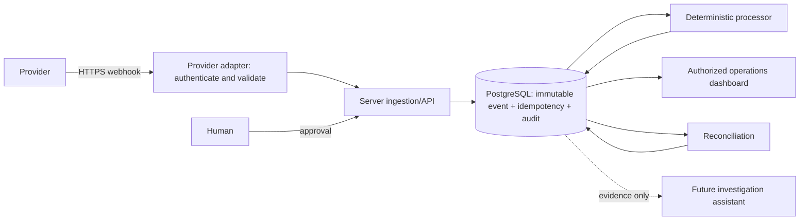

# Architecture

**Status:** Proposed architecture; no implementation was present in the 2026-09-29 repository audit.

## Repository audit

`D:\IdemPulse` contained no project files at audit time: no framework, package manifest/lockfile, source tree, Git metadata, environment files, database/Supabase setup, authentication, tests, or deployment configuration. Consequently there is no existing architecture or functionality to preserve and no Git history available here to inspect for leaked secrets. This is a workspace observation, not a claim about external repositories or backups.

## MVP shape

Start with a single web application and PostgreSQL. Next.js/TypeScript is the proposed frontend and server API only if that is the user's intended stack; Supabase may provide managed PostgreSQL/auth once deployment and account choices are known. Do not add Cloudflare, a separate FastAPI/C++ service, Redis, or a queue until requirements and deployment constraints justify them. PostgreSQL transactions and constraints remain the correctness boundary.

## Event and state model

Canonical records should include event ID, provider and provider event ID, event type, aggregate ID/type, optional sequence number, provider timestamp, received/processed timestamps, causation/correlation IDs, idempotency key, payload, payload hash, schema version, processing status, attempt count, and safe error code/message. Persist enough verified request metadata for audit while minimizing sensitive data. Enforce provider-scoped uniqueness in PostgreSQL; use a transaction/unique constraint to resolve races. Payload immutability and retention policy require a migration/design decision.

Aggregate transitions are explicit server-side state machines. Reject or quarantine invalid transitions. Sequence numbers and provider semantics take precedence where reliable; causation/correlation and transition validity inform ordering. Arrival timestamps are not causal order. If a predecessor may be missing, keep the event in `PENDING_ORDER` rather than silently reordering.

## Retry, DLQ, and replay

Retry only classified transient failures with bounded exponential backoff and jitter, respecting provider semantics. Persist attempt and next-attempt state. Terminal/exhausted work is visible in a durable DLQ state. Replay reuses the original event identity/evidence, creates an auditable replay action, and passes through the same authorization, idempotency, and deterministic processing boundaries. External side effects need their own idempotency contract.

## Reconciliation and incidents

Reconciliation compares provider, application, and (when available) settlement records. Store run metadata, matched counts, discrepancy categories, evidence references, and status; never synthesize production metrics. Incidents reference affected aggregates/events and carry severity, lifecycle, evidence, timeline, recommendation, approval, and remediation status.

## Authentication, tenancy, and security boundaries

Identity must come from a verified server session. Every tenant-owned query/mutation checks organization membership and role server-side; database RLS/policies provide defense in depth. Never expose service-role/database/provider/AI secrets in client code. Verify webhook authenticity before processing and apply payload limits, schema validation, replay tolerance, and rate limiting without breaking legitimate provider retries. Configure restrictive CORS, HTTPS, secure cookies, and production headers at deployment.

## Future AI, queues, cache, and C++

AI investigation is read-only over authorized evidence by default: gather event history, state, logs and relevant provider documentation; return hypothesis, confidence, cited evidence, risk, expected result, and recommended action. Policy and human approval gate mutations; financial/ledger changes always require explicit approval. A queue can later improve throughput, but durable database state/outbox patterns must prevent lost work. Redis may cache or coordinate but cannot be the sole idempotency store. A C++ engine is deferred until representative benchmarks show a meaningful gain and a stable API boundary is defined.

## Failure modes to design for

Duplicate/concurrent delivery, invalid signature, malformed/oversized payload, provider timeout, database transaction failure, worker crash after commit, missing predecessor, invalid state transition, exhausted retry, provider outage, replay race, cross-tenant authorization failure, and reconciliation source mismatch. Each must have a durable or safely rejected outcome, request/correlation identifiers, and non-sensitive diagnostics.

## Deployment and scaling

Unknown: hosting, regions, data residency, expected volume/latency, provider list, and availability target. Decide these before selecting Cloudflare/Supabase topology. Begin with measured indexes, bounded work, and operational metrics; scale workers/queues only against observed bottlenecks.
